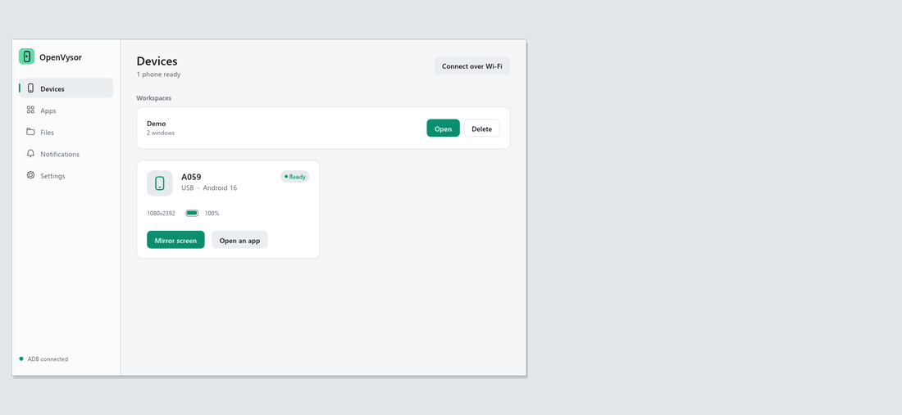

<div align="center">

# OpenVysor

**কম্পিউটারে অ্যান্ড্রয়েড ফোনের স্ক্রিন দেখুন ও চালান, সম্পূর্ণ ফ্রি ও ওপেন সোর্স।**

পুরো ফোন খুলুন, অথবা প্রতিটি অ্যাপকে দিন ফোনের আকারের আলাদা উইন্ডো।
Rust-এ লেখা একটিমাত্র ছোট নেটিভ অ্যাপ। কোনো অ্যাকাউন্ট নেই, ক্লাউড নেই, রুট লাগে না।

[English](README.md) · [**ওয়েবসাইট**](https://sahinurdev.github.io/OpenVysor/bn.html) ·
[**ডাউনলোড**](https://github.com/SahinurDEV/OpenVysor/releases) ·
[**ডকুমেন্টেশন**](https://sahinurdev.github.io/OpenVysor/docs.html)



</div>

> **শুরুর দিকের সংস্করণ।** OpenVysor ব্যবহার করা যায়, তবে এটি এখনো নতুন। এখন পর্যন্ত
> Android 16 চালিত একটি ফোনে পরীক্ষা হয়েছে। কোন ফিচার আসল ফোনে যাচাই করা হয়েছে, তা
> [ফিচার তালিকায়](docs/FEATURE_STATUS.md) লেখা আছে।

## OpenVysor কী করে

- **এক অ্যাপ, এক উইন্ডো।** প্রতিটি অ্যান্ড্রয়েড অ্যাপ নিজের ভার্চুয়াল ডিসপ্লেতে চলে, তাই
  কম্পিউটারে কয়েকটা অ্যাপ পাশাপাশি খোলা রাখা যায়, আর ফোনটাও ফাঁকা থাকে।
- **পুরো ফোন দেখা।** চাইলে ফোনের পুরো স্ক্রিন কম্পিউটারে খুলে মাউস আর কিবোর্ড দিয়ে চালান।
- **ছোট ও নেটিভ।** Windows-এ প্রায় ৬ MB-এর একটি Rust প্রোগ্রাম, কোনো ব্রাউজার ইঞ্জিন নেই।
- **প্রাইভেসি।** ভিডিও আর নিয়ন্ত্রণ শুধু আপনার ফোন ও কম্পিউটারের মধ্যে, USB বা আপনার
  নিজের Wi-Fi দিয়ে চলে। কোনো অ্যাকাউন্ট বা সার্ভার নেই।
- **আরও যা আছে:** দুই দিকেই ক্লিপবোর্ড, স্ক্রিনশট ও MP4 রেকর্ডিং, Wi-Fi সংযোগ, ফাইল
  ব্রাউজার, টেনে এনে APK ইনস্টল ও ফাইল পাঠানো, আর ফোনের নোটিফিকেশন দেখা।

## ডাউনলোড

| কম্পিউটার | ফাইল |
| --- | --- |
| Windows x64 | `-setup.exe` (ইনস্টলার, আনইনস্টল করা যায়), `.exe` (ইনস্টল ছাড়া চলে), `.zip` |
| macOS, Apple Silicon ও Intel | `.dmg`, `.zip` |
| Linux x64 | `.deb`, `.tar.gz`, অথবা [Flatpak](packaging/flatpak/README.md) বানিয়ে নিন |

[ওয়েবসাইট](https://sahinurdev.github.io/OpenVysor/bn.html#install) আপনার কম্পিউটার চিনে
সঠিক ফাইলটি দেখায়। সব সংস্করণ পাবেন [Releases](https://github.com/SahinurDEV/OpenVysor/releases)-এ।

## ইনস্টল

ফোনে **USB debugging** চালু থাকতে হবে। Windows, macOS ও Linux x64-এ অ্যাপ নিজেই এক ক্লিকে অ্যান্ড্রয়েডের
`adb` টুল ইনস্টল করে দিতে পারে। নিজে ইনস্টল করতে চাইলে:

| কম্পিউটার | adb ইনস্টল |
| --- | --- |
| Windows | [SDK Platform-Tools](https://developer.android.com/tools/releases/platform-tools) ডাউনলোড করে `%LOCALAPPDATA%\OpenVysor`-এ আনজিপ করুন |
| macOS | `brew install android-platform-tools` |
| Debian বা Ubuntu | `sudo apt install adb android-sdk-platform-tools-common` |

**Windows:** `OpenVysor-windows-x64-setup.exe` চালান। এতে অ্যাডমিনিস্ট্রেটর অনুমতি লাগে না,
আর পরে **Settings → Apps → Installed apps** থেকে মুছে ফেলা যায়। অ্যাপটি এখনো সাইন করা নয়,
তাই সতর্কবার্তা এলে **More info**, তারপর **Run anyway** চাপুন।

**Mac:** অ্যাপটি Applications-এ টেনে আনুন, একবার খোলার চেষ্টা করুন, তারপর
**System Settings → Privacy & Security → Open Anyway** চাপুন।

বিস্তারিত আছে [ইনস্টল নোটে](docs/PLATFORM_SETUP.md)।

## শুরু করুন

1. ফোনে Developer options চালু করে **USB debugging** অন করুন।
2. OpenVysor খুলুন। অ্যাপ জিজ্ঞেস করলে **Install ADB** চাপুন।
3. USB ডেটা কেবল দিয়ে ফোন লাগান এবং ফোনে **Allow** চাপুন।
4. **Mirror screen** বা **Open an app** বেছে নিন।
5. তার ছাড়া চালাতে চাইলে, USB-তে লাগানো অবস্থায় **Use over Wi-Fi** চাপুন। অথবা QR কোড,
   পেয়ারিং কোড বা IP ঠিকানা দিয়ে যুক্ত করুন।

Xiaomi ফোনে ইনপুট কাজ করার জন্য **USB debugging (Security settings)**-ও চালু করতে হয়।

## নিয়ন্ত্রণ

| ইনপুট | কাজ |
| --- | --- |
| বাম ক্লিক ও টেনে আনা | টাচ ও সোয়াইপ |
| ডান ক্লিক | পেছনে যাওয়া, বা স্ক্রিন জাগানো |
| মাঝের বাটন | হোম |
| স্ক্রল হুইল | পয়েন্টারের নিচে স্ক্রল |
| `F11` | ফুল স্ক্রিন |
| `Ctrl` + `1`–`5` | মূল উইন্ডোর পেজ বদলানো |
| `Ctrl` + `Shift` + `O` | যেকোনো জায়গা থেকে OpenVysor সামনে আনা (macOS-এ `Cmd`) |
| `Alt` + `←` / `→` | আগের বা পরের ফোন উইন্ডো |
| উইন্ডোতে ফাইল ফেলা | APK হলে ইনস্টল, অন্য ফাইল ফোনের Download-এ যায় |

## সোর্স থেকে বানানো

[Rust](https://rustup.rs) ইনস্টল করুন। Linux-এ `libasound2-dev`, `nasm` ও `pkg-config`-ও লাগবে।

```sh
git clone https://github.com/SahinurDEV/OpenVysor.git
cd OpenVysor/native
cargo build --release
cargo test
```

## অবদান রাখা

বাগ রিপোর্ট, অন্য ফোনে পরীক্ষা আর pull request, সবই স্বাগত। অনুগ্রহ করে
[CONTRIBUTING.md](CONTRIBUTING.md) ও [Code of Conduct](CODE_OF_CONDUCT.md) পড়ুন। নিরাপত্তা
সমস্যা জানাতে [SECURITY.md](SECURITY.md) দেখুন।

## লাইসেন্স

[Apache License 2.0](LICENSE)-এর অধীনে প্রকাশিত। সাথে থাকা অংশগুলোর তথ্য, যেমন
[scrcpy-server](https://github.com/Genymobile/scrcpy), আছে [NOTICE](NOTICE)-এ।

OpenVysor একটি স্বাধীন প্রজেক্ট, Vysor-এর নির্মাতাদের সাথে এর কোনো সম্পর্ক নেই। Android হলো
Google LLC-এর ট্রেডমার্ক।
