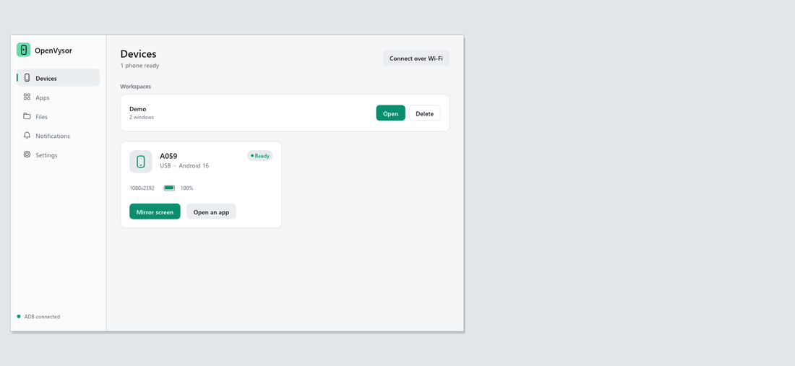
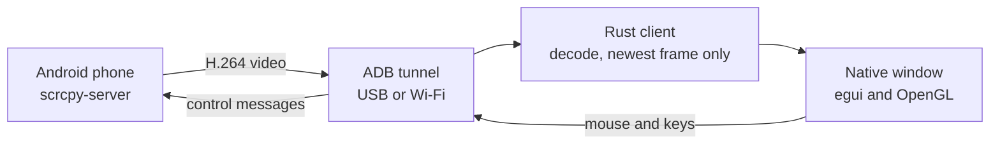

<div align="center">

# OpenVysor

**Free, open-source Android screen mirroring and control for your computer.**

Open the whole phone, or give every app its own phone-shaped window.
One small native Rust app. No account, no cloud, no root.

[](https://github.com/SahinurDEV/OpenVysor/actions/workflows/ci.yml)
[](https://github.com/SahinurDEV/OpenVysor/releases)
[](LICENSE)


[বাংলা](README.bn.md) ·
[**Website**](https://sahinurdev.github.io/OpenVysor/) ·
[**Download**](https://github.com/SahinurDEV/OpenVysor/releases) ·
[**Documentation**](https://sahinurdev.github.io/OpenVysor/docs.html) ·
[**Roadmap**](#roadmap)



</div>

> **Early development.** OpenVysor is usable, but young. Testing so far has used one phone
> running Android 16, and the [feature table](#features) says exactly what has been confirmed.

## Why OpenVysor

- **One app, one window.** Each Android app runs on its own virtual display, so several can
  sit side by side on your desktop while the phone stays free.
- **Native and small.** One Rust program of about 6 MB on Windows, with no browser engine.
- **Private by design.** Video and input travel only between your phone and your computer.
  There is no account and no server.
- **Quick to open.** A phone window appears in 245–367 ms, with the first picture at about
  0.95 s (measured over USB on one phone, after the first window of a session).

## Features

| Feature | Status |
| --- | --- |
| Live video of an app in its own window | ✅ Confirmed on a real phone |
| Mouse tapping | ✅ Confirmed on a real phone |
| Phone-shaped windows, toolbar and full screen | ✅ Confirmed |
| Clean exit, with nothing left running | ✅ Confirmed |
| Clipboard sync, both ways | ✅ Confirmed on a real phone |
| Screenshots and MP4 recording | ✅ Confirmed on a real phone |
| Whole-phone mirroring | 🧪 Picture confirmed; mouse input being tested |
| Dragging, scrolling, typing and rotation | 🧪 Written, being tested |
| Automatic reconnection | 🧪 Written, being tested |
| Wi-Fi by QR code, pairing code, IP address, or one click from USB | 🧪 Written, being tested |
| Drag and drop for APKs and files | 🧪 Written, being tested |
| Phone sound on your computer | 🧪 Written, being tested |
| Workspaces, per-app quality and remembered positions | 🧪 Written, being tested |
| Key mapping for games | 🧪 Written, being tested |
| File browser with sizes, filter, download and upload | 🧪 Listing confirmed on a real phone; transfers being tested |
| Phone notifications (optional, read-only) | 🧪 Reading confirmed on a real phone; page being tested |
| Tray icon and global shortcut (Windows and macOS) | 🧪 Written, being tested |

The full record is in [docs/FEATURE_STATUS.md](docs/FEATURE_STATUS.md).

## Platform support

| Platform | Builds and unit tests | App opens | Mirrors a real phone |
| --- | --- | --- | --- |
| Windows 10/11 x64 | ✅ | ✅ | ✅ App windows |
| Linux x64 | ✅ | ✅ Virtual display | ⏳ Not yet |
| macOS (Apple Silicon and Intel) | ✅ GitHub Actions | ⏳ Not yet | ⏳ Not yet |

## Downloads

| Computer | Formats |
| --- | --- |
| Windows x64 | `-setup.exe` (installer with uninstaller), `.exe` (portable), `.zip` |
| macOS, Apple Silicon and Intel | `.dmg`, `.zip` |
| Linux x64 | `.deb`, `.tar.gz`, or build the [Flatpak](packaging/flatpak/README.md) |

## Quick start

You need a phone with **USB debugging** turned on. On Windows, macOS and Linux x64, the app can
install Android's `adb` tool for you with one click. To install it yourself instead:

| Computer | Install adb |
| --- | --- |
| Windows | Download [SDK Platform-Tools](https://developer.android.com/tools/releases/platform-tools) and unzip it into `%LOCALAPPDATA%\OpenVysor` |
| macOS | `brew install android-platform-tools` |
| Debian or Ubuntu | `sudo apt install adb android-sdk-platform-tools-common` |

1. Download the package for your computer from the
   [website](https://sahinurdev.github.io/OpenVysor/#install), which detects it for you, or from
   [Releases](https://github.com/SahinurDEV/OpenVysor/releases), which keeps every version.
2. Install and open OpenVysor. On Windows, run `OpenVysor-windows-x64-setup.exe`; it needs no
   administrator rights, and you can remove it later from **Settings → Apps → Installed apps**.
   See [install notes](docs/PLATFORM_SETUP.md) for the security prompts on unsigned builds.
3. If the app asks, choose **Install ADB**.
4. Connect the phone with a USB data cable and tap **Allow** on the phone.
5. Choose **Mirror screen** or **Open an app**.

## Controls

| Input | Action |
| --- | --- |
| Left click and drag | Touch and swipe |
| Right click | Back, or wake the screen |
| Middle click | Home |
| Scroll wheel | Scroll under the pointer |
| `F11` | Full screen |
| `Ctrl` + `1`–`5` | Switch pages in the main window |
| `Ctrl` + `Shift` + `O` | Bring OpenVysor forward from anywhere (`Cmd` on macOS) |
| `Alt` + `←` / `→` | Previous or next phone window |
| Drop a file on a window | Install an APK, or send a file to Download |

## How it works



OpenVysor pushes the unmodified, embedded `scrcpy-server` to the phone and connects to it
through an ADB tunnel. H.264 is decoded by the decoder built into Windows, or by OpenH264 on
macOS and Linux. Child processes are tied to the app's lifetime, so nothing is left running
even after a crash. More detail is in [docs/ARCHITECTURE.md](docs/ARCHITECTURE.md).

## Build from source

Install [Rust](https://rustup.rs). On Linux, also install `libasound2-dev`, `nasm` and
`pkg-config`.

```sh
git clone https://github.com/SahinurDEV/OpenVysor.git
cd OpenVysor/native
cargo build --release
cargo test
```

## Repository layout

| Path | Contents |
| --- | --- |
| `native/` | The current app, in Rust |
| `src/`, `src-tauri/` | The earlier Tauri and React version |
| `docs/` | Project documentation |
| `.github/workflows/` | CI on every push, and release packaging on version tags |

## Roadmap

- Confirm the remaining features on real phones, and on real Macs and Linux PCs
- Measure end-to-end latency, and stop frame backlogs from building up
- Hardware video decoding
- Installers and code signing
- Sound in recordings

## Documentation

- [User guide](https://sahinurdev.github.io/OpenVysor/docs.html)
- [Installing on each platform](docs/PLATFORM_SETUP.md)
- [Feature status](docs/FEATURE_STATUS.md)
- [Architecture](docs/ARCHITECTURE.md)
- [Testing](docs/TESTING.md)
- [Changelog](CHANGELOG.md)

## Contributing

Bug reports, testing on other phones and pull requests are all welcome. Please read
[CONTRIBUTING.md](CONTRIBUTING.md) and the [Code of Conduct](CODE_OF_CONDUCT.md). To report a
vulnerability, see [SECURITY.md](SECURITY.md).

## License

Released under the [Apache License 2.0](LICENSE). See [NOTICE](NOTICE) for bundled components,
including [scrcpy-server](https://github.com/Genymobile/scrcpy).

OpenVysor is an independent project and is not affiliated with or endorsed by the makers of
Vysor. Android is a trademark of Google LLC.
